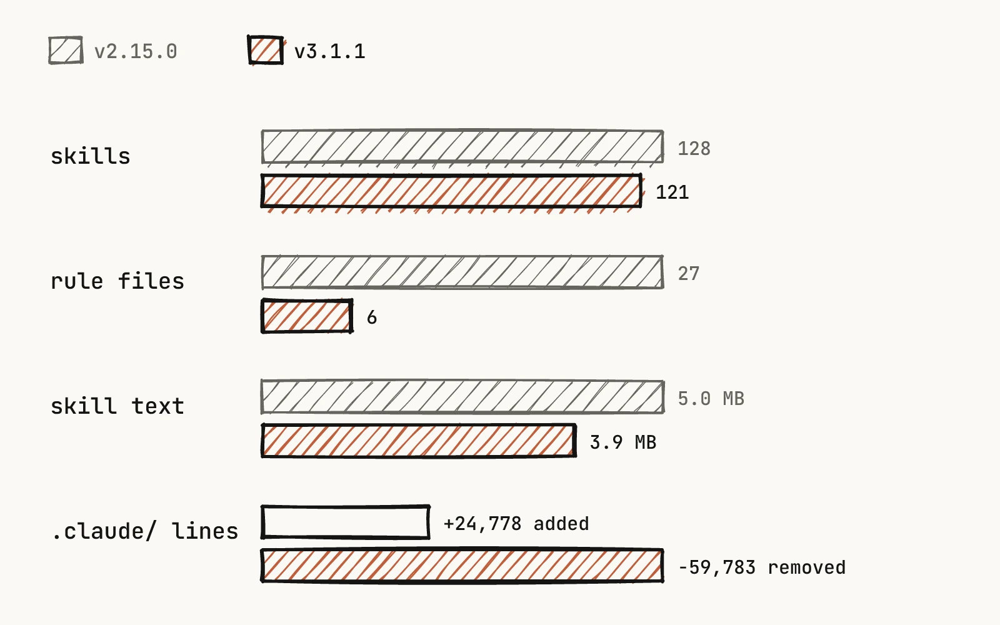

At the end of [Why I built MeowKit](/posts/why-i-built-meowkit) I wrote that
version 3 would be mostly about taking things out. It shipped on 20 November
2026, and the current release is 3.1.1 from 26 November. This post compares it
with v2.15.0, the last v2 release (27 July 2026), and ends with the steps to move
over.

| | v2.15.0 | v3.1.1 |
|---|---|---|
| Approval gates | Gate 1 (plan), Gate 2 (review) | none |
| Ship check | full test suite, lint, type-check; blocks on Claude Code | changed files and related tests; every runtime |
| Runtimes | Claude Code, Codex as experimental | seven, from one source |
| CLI | `npx mewkit` | native `mewkit` binary (`mk`) |
| Team memory | three topic files, gitignored | two files, committed |
| Skills | 128 | 121 |
| Rule files | 27 | 6 |
| Agents | 42 | 42 |

## The approval gates are gone

v2 had two gates, and the first post spent a whole section on them. Gate 1
blocked any edit to source code until a person had approved a plan. Gate 2
blocked the ship phase until a review verdict file existed.

v3 removes both, on every runtime. An agent can edit source with no approved plan
and commit with no review verdict. Planning and review are still phases of the
workflow, but no hook stops on them. The commands that served the gates went with
them: `mewkit plan approve`, `mewkit verdict-gate` and `mewkit validate --gates`.


What is left is the ship check, and it changed too. In v2, `pre-ship.sh` ran
the full test suite, lint and a type-check on `git commit`, `git push` and
`git merge`. It could block only on Claude Code, and the `fast` hook profile
skipped it. In v3 it also runs on `gh pr create` and `gh pr merge`, on every runtime, and the
`fast` profile no longer skips it. It lints the files you changed, runs the
tests related to them and runs a type-check, and refuses the command if any of
them fails. When the test runner cannot tell which tests are related, it runs
lint and the type-check only and says that tests did not run.

Since 3.1.0 the check fails closed. If it cannot run at all, because of a crash,
a missing tool or its 270-second deadline, it prints `PRE-SHIP COULD NOT RUN`
instead of letting the command through. On Claude Code that case becomes a
permission prompt, so you decide. A check that ran and failed is still refused.
`--no-verify`, a skip variable and the Cursor kill switch do not turn it off.

## One source, seven runtimes

v2 was a Claude Code kit. Codex support was an experimental projection, and the
README said so: on Codex the gates warned but could not block a write.

v3 is written once, in `.claude/`. `mewkit init` turns that tree into the files
each runtime reads and adds a small per-runtime overlay from `kit/overlays/`.
3.0.0 installs on Claude Code, Codex, Cursor, Grok, Pi and OMP, and 3.1.0 adds
Antigravity as a seventh.


The seven are not at the same level yet. For Grok, Pi and OMP the changelog
says their enforcement is documented by the vendors but has not been run in a
live session. Antigravity was built from its vendor docs, nothing was probed
live, and `init` and `doctor` call its guards unverified. What each runtime
enforces is on the
[enforcement page](https://docs.meowkit.dev/core-concepts/enforcement).

Some runtimes also read each other's folders. Cursor, for one, loads `.claude/`
and `.agents/skills` as well as its own. So where the files land depends on
which runtimes you install together, and `mewkit doctor` warns when a runtime
loads the same kit skill from two places.

## A native CLI instead of npx

In v2 everything went through `npx mewkit`. v3 ships a native `mewkit` binary,
with `mk` as a shorter name for the same program. The installer checks the
archive's size and SHA-256 against pins it carries before it puts the binary on
your PATH, and `mewkit self-update` handles updates after that. The npm package
gets no new fixes.

## Team memory moves into git

v2 kept memory in three topic files, `fixes.md`, `review-patterns.md` and
`architecture-decisions.md`. They were machine-local and gitignored, so each
machine built up its own.

v3 has two files, and they are committed: `.meowkit/memory/decisions.md` for
why a non-obvious choice was made, and `gotchas.md` for what a real failure
taught. Agents read them with one grep when a task starts and add entries with
`mewkit note`. Because the files are in git, everyone on the project reads the
same memory, and a new entry can be reviewed in a pull request like any other
change.


## Skills fitted to current models

Each agent is now pinned to a model by tier, and the Codex and Cursor agent
files follow the same table. Rules and skill bodies give a reason instead of an
all-caps NEVER. NEVER stays for force-push, pushing to main and the security
rules.

In 3.1.0 every skill was rewritten around its goal. Each `SKILL.md` opens with
what the skill is for, when to use it and when to use a sibling instead. Rules
that `.claude/rules/`, another skill or the CLI already own are pointed to, not
repeated.

`/mk:autobuild` now runs its light LEAN mode on Opus 5 and Fable 5: the contract
is optional and there is at most one iteration round. The changelog notes that
neither model has been replayed against the calibration set yet. If you want the
old scaffolding back, set `MEOWKIT_AUTOBUILD_MODE=FULL`.

3.1.0 also adds tools for changing skills safely. `mewkit skill overlay`, `fork`
and `rollback` keep your own version of a kit skill across upgrades.
`mewkit eval run` and `mewkit eval compare` measure a skill against the kit's
cases (104 in the baseline suite), from a checkout of the MeowKit repository.

## It got smaller



Between the v2.15.0 and v3.1.1 tags there are 526 commits. In `.claude/` they
add 24,778 lines and remove 59,783, so the folder lost more than twice what it
gained. The files under `.claude/skills/` went from 5.0 MB to 3.9 MB, and seven
skills fewer ship. The agent count did not change.

## Moving from v2

Install the binary. On macOS and Linux:

```bash
curl -fsSL https://raw.githubusercontent.com/ngocsangyem/MeowKit/main/install.sh | sh
```

On Windows, in PowerShell:

```powershell
irm https://raw.githubusercontent.com/ngocsangyem/MeowKit/main/install.ps1 | iex
```

Then remove the npm package, with `npm uninstall -g mewkit` or by dropping
`mewkit` from a project's `devDependencies`. A project that still has it in
`node_modules/.bin` keeps running the old CLI until you do.

In each project, check the install and upgrade it:

```bash
mewkit doctor
mewkit upgrade
```

`upgrade` removes the gate hooks and their files. Two more things can catch you:

- If `~/.meowkit/config.yaml` still has `gate1PresenceOnly`, `doctor` reports
  the config as invalid. Delete that line.
- On Codex, a new or changed hook runs only after you review it. Review the
  hooks once after upgrading, or the ship check stays off.

For a new project, run `mewkit init` and pick the runtimes in its picker. The full release notes are in the
[changelog](https://docs.meowkit.dev/changelog), and the code is on
[GitHub](https://github.com/ngocsangyem/MeowKit).
