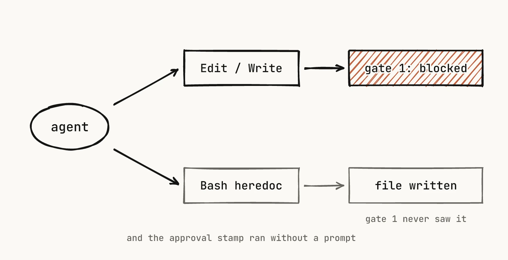

At the end of [Why I built MeowKit](/posts/why-i-built-meowkit) I wrote that v3
would be mostly about taking things out, because a stronger model does not need
all the structure a weaker one did. Before cutting anything, I wanted to know
whether that was true and what in the kit actually worked. So on 15 November
2026 I had the kit researched. v3.0.0 shipped on 20 November, five days later,
and the current release is 3.1.1.

This post covers what the research found, what v3 changed because of it, and how
to move over from v2.15.0, the last v2 release.

| | v2.15.0 | v3.1.1 |
|---|---|---|
| Approval gates | Gate 1 (plan), Gate 2 (review) | none |
| Ship check | full test suite, lint, type-check; blocks on Claude Code | changed files and related tests; every runtime |
| Runtimes | Claude Code, Codex as experimental | seven, from one source |
| CLI | `npx mewkit` | native `mewkit` binary (`mk`) |
| Team memory | three topic files, gitignored | two files, committed |
| Skills | 128 | 121 |
| Rule files | 27 | 6 |
| Agents | 42 | 42 |

## What the research looked at

The research read MeowKit's hooks, rules, settings, 42 agents, CLI and memory,
and ran the hooks in scratch copies. It read the source of four other agent
harnesses (deepseek-harness, qwen-code, hermes-agent and rig) and of Codex,
Gemini CLI, OpenCode and Pi. A separate auditor opened 47 arXiv papers, four CVEs
and the vendor pages at their primary source and corrected several numbers.
Nothing was run against a model with and without MeowKit, so no part of it
measures whether the kit makes an agent better. The report says so first.

Three findings shaped v3.

### Always-on text did not pay off, checks did

The idea that newer models need less scaffolding held only for one kind of
scaffolding: prescriptive text that is loaded every time.

- In a controlled study (arXiv 2602.11988), context files written by an LLM
  changed the resolve rate by -0.5% and -2%, neither significant, and cost about
  20% more. Files written by developers helped by +2.4%, also not significant.
- In SkillsBench, skills the model wrote for itself scored 8.1 to 11.5 points
  below having no skill at all. Curated skills added 16.6 points.
- Anthropic's Fable 5 guide says skills written for earlier models are often too
  prescriptive, and its best-practices page says emphatic MUST and CRITICAL
  wording makes newer models over-trigger a tool.

The mechanisms that kept their value as models improved were operational ones:
checking the result against the tests, review in a fresh context, isolation and
approval before an irreversible action. In Anthropic's own harness write-up,
context resets and sprint decomposition were dropped as models got better, and
the planner and evaluator stayed.


These are vendor and harness accounts plus one controlled study on models older
than the current generation. The direction agrees across them. How much it matters for the current
generation is not measured.

### The gates did less than they claimed

Gate 1 was registered only on the Edit and Write tools. A file written by a Bash
command never reached it. During the research two agents hit Gate 1 while
writing scratch files with Write, then wrote the same files with Bash heredocs,
and nothing stopped them. The research concluded that a guard
that blocks the checked tool and leaves the unchecked one open pushes agents
toward the unchecked one.

The approval itself could be stamped by the agent. `approval-receipt.cjs stamp`
took the approver as an argument with `human` as the default, its own header
called the receipt "agent-writable by design", and the shipped settings allowed
`Bash(node .claude/hooks/*)` without a prompt.



The three documented exceptions to Gate 1 for small work had no implementation.
`mk:fix` said a simple fix had no plan to track, and the hook still asked for a
plan and a receipt. The sprint-contract gate, which the rules scope to full
autobuild, also fired on plain `/mk:cook` plans. A full run asked for
about 83,000 tokens of workflow text and five or six stops for a person, and the
research cites documentation that users approve about 93% of permission prompts.

The gates did stop accidental, unplanned work, and the research said so. It did
not recommend removing them: its proposed decision was to keep both and make the
exceptions real. I decided to remove both and keep the ship check, which runs at
commit time whatever tool wrote the files.

### The model handling had plain bugs

Autobuild's density selector chose how much structure to add from a list of
model ids. It gave LEAN to `claude-opus-4-7` and FULL, the most structure, to
`claude-opus-5-5`, `claude-sonnet-5-5` and `claude-fable-5-2`. The newest models
got more scaffolding than an older one, the opposite of what the density table
said it did, and the selector, the model detector and the doc gave three
different answers. Twelve agents were pinned to the bare id `claude-opus-5`, and
the tier routing (TRIVIAL, STANDARD, COMPLEX) was printed text that no hook or
script turned into a model choice.

## Gates removed, ship check tightened

v3 removes both gates on every runtime. An agent can edit source with no
approved plan and commit with no review verdict. Planning and review are still
phases of the workflow, but no hook stops on them. `mewkit plan approve`,
`mewkit verdict-gate` and `mewkit validate --gates` are gone, along with about
1,860 lines of Rust gate code.


Removing them means a small fix no longer needs a plan and a
receipt, no hook blocks an Edit that a Bash write would get past, and there is
no approval step that an agent could stamp for itself.

The ship check is what stayed, and the research had found holes in it too. In
v2, `pre-ship.sh` matched the literal text `git commit`, `git push` or
`git merge`. It missed `git  commit`, `git -C . commit`, `git -c k=v commit`, an
alias such as `git ci`, and `gh pr create` or `gh pr merge`. Its hook had a
30-second limit, and a hook the host stopped at its timeout let the command
through. The `fast` hook profile skipped it, and it blocked only on Claude Code.

In v3 the check splits the command into words, skips git's global options,
resolves aliases through `git config`, and covers `gh pr create` and
`gh pr merge`. It runs on every runtime and the `fast` profile does not skip it.
It lints the files you changed, runs the tests related to them and runs a
type-check. When the test runner cannot name related tests, it runs lint and the
type-check only and says that tests did not run.

Since 3.1.0 it fails closed. If it cannot run, because of a crash, a missing tool
or its 270-second deadline, it prints `PRE-SHIP COULD NOT RUN` instead of letting
the command through. On Claude Code that case becomes a permission prompt, so you
decide. A check that ran and failed is still refused. `--no-verify`, a skip
variable and the Cursor kill switch do not turn it off. A ship run inside `bash -c`,
`eval` or a script file is still not seen; the matcher lists that as a known
limit.

## The model handling, fixed

On Claude Code, Opus 5 and Fable 5 now get LEAN density, the same rule Opus 4.6
and 4.7 already had: the contract is optional and there is at most one
iteration round. The changelog notes that neither model has been replayed
against the calibration set yet, and `MEOWKIT_AUTOBUILD_MODE=FULL` brings the old
scaffolding back.

Each agent's model now follows its tier from one table, and the Codex and Cursor
agent files are generated from the same table. Thirteen Codex agents had been
pinned to a retired id.

Rules and skill bodies give a reason instead of an all-caps NEVER. NEVER stays
for force-push, pushing to main and the security rules. In 3.1.0 every skill was
rewritten around its goal: each `SKILL.md` opens with what the skill is for,
when to use it and when to use a sibling, and it points to rules other files own
instead of repeating them.

Hook advice now reaches the model. Loop detection, the pre-task check and the
post-write warnings used to print plain output, which Claude Code's docs say the
model does not see. They now send it as `additionalContext`.

The research's other point was that nothing measures any of this. 3.1.0 adds
`mewkit eval run` and `mewkit eval compare`, which drive Claude Code or Codex
over the kit's cases (104 in the baseline suite) from a checkout of the MeowKit
repository. It is the first piece that can show whether a change to a skill
helps.

## One source, seven runtimes

v2.15.0 was a Claude Code kit with an experimental Codex projection, and its
README said that on Codex the gates warned but could not block. After that
release, Codex and Cursor support lived in hand-written bundles. At the research
baseline none of their `SKILL.md` files matched the Claude Code original (0 of
125 for Codex, 0 of 124 for Cursor), so every change had to be made three times.

v3 is written once, in `.claude/`. `mewkit init` turns that tree into the files
each runtime reads, plus a small overlay per runtime from `kit/overlays/`. 3.0.0
installs on Claude Code, Codex, Cursor, Grok, Pi and OMP, and 3.1.0 adds
Antigravity.


The seven are not at the same level. For Grok, Pi and OMP the changelog says the
enforcement is documented by the vendors but has not been run in a live
session. Antigravity was built from its vendor docs and nothing was probed live.
What each runtime enforces is on the
[enforcement page](https://docs.meowkit.dev/core-concepts/enforcement).

## Smaller changes

v3 ships a native `mewkit` binary, with `mk` as a shorter name for it. The
installer checks the archive's size and SHA-256 against pins it carries, and
`mewkit self-update` handles updates. The npm package gets no new fixes.

Team memory is two committed files, `.meowkit/memory/decisions.md` and
`gotchas.md`, written with `mewkit note` and read with one grep at task start.
In v2 it was three gitignored topic files on each machine. The research found
the memory store had never held content in the repo, so whether memory improves
results is still unknown.


Between the v2.15.0 and v3.1.1 tags there are 526 commits. In `.claude/` they
add 24,778 lines and remove 59,783. The files under `.claude/skills/` went from
5.0 MB to 3.9 MB.


## Moving from v2

Install the binary. On macOS and Linux:

```bash
curl -fsSL https://raw.githubusercontent.com/ngocsangyem/MeowKit/main/install.sh | sh
```

On Windows, in PowerShell:

```powershell
irm https://raw.githubusercontent.com/ngocsangyem/MeowKit/main/install.ps1 | iex
```

Remove the npm package with `npm uninstall -g mewkit`, or drop `mewkit` from a
project's `devDependencies`. A project that still has it in `node_modules/.bin`
keeps running the old CLI until you do. Then, in each project:

```bash
mewkit doctor
mewkit upgrade
```

`upgrade` removes the gate hooks and their files. If `~/.meowkit/config.yaml`
still has `gate1PresenceOnly`, `doctor` reports the config as invalid; delete
that line. On Codex, a new or changed hook runs only after you review it, so
review the hooks once after upgrading or the ship check stays off.

For a new project, run `mewkit init` and pick the runtimes in its picker. The
release notes are in the [changelog](https://docs.meowkit.dev/changelog) and the
code is on [GitHub](https://github.com/ngocsangyem/MeowKit).
