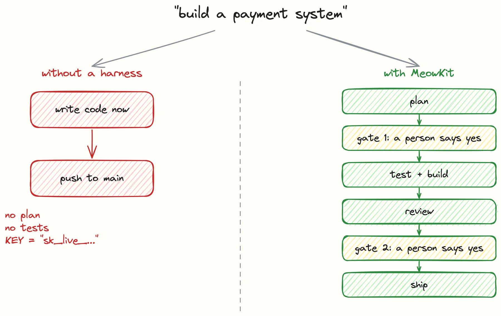
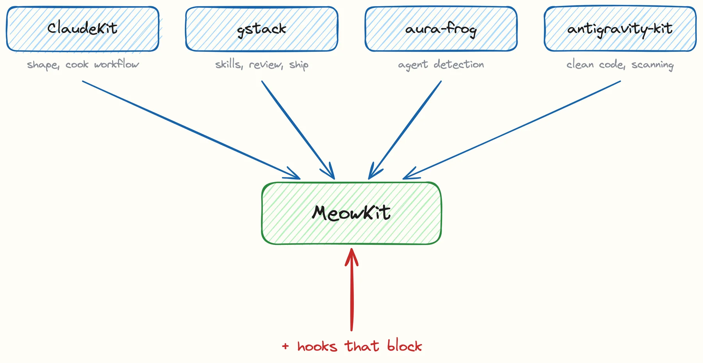
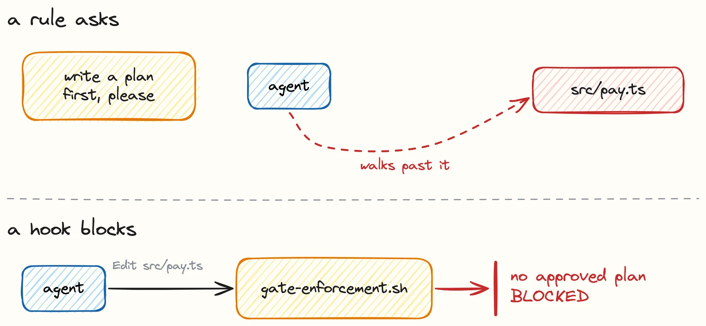
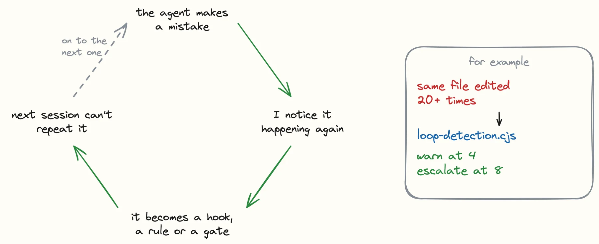
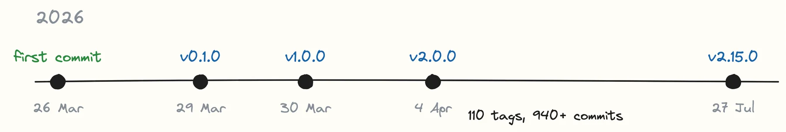
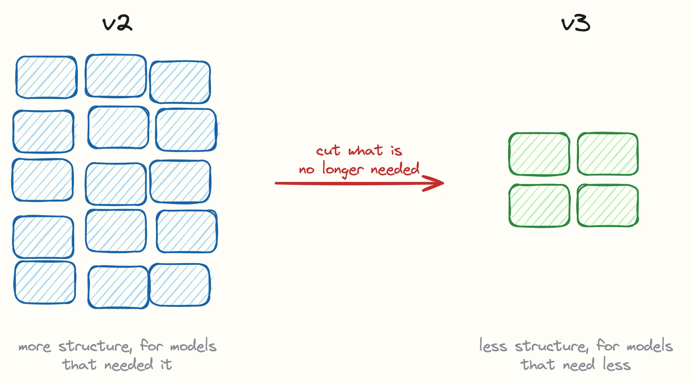

MeowKit is a set of skills for Claude Code that are made to work together. Some
of them are harness skills: `mk:plan-creator`, `mk:cook`, `mk:review`, `mk:ship`
and `mk:fix` carry a task from plan to ship, one phase at a time. Around them sit
satellite skills, and each of those does one job. `mk:scout` finds the files that
matter, `mk:docs-finder` looks up library docs, and `mk:verify` runs the build,
lint and tests. A harness skill calls a satellite when it needs one, so the same
`mk:scout` is used for planning, building, review and fixing.

The third part is the `mewkit` CLI. Some steps are better done by a small program
than by a prompt, so the CLI gives agents the tools for them. `mewkit task new`
starts a task file from a template. `mewkit plan approve` stamps the Gate 1
approval onto a plan after a person has approved it. `mewkit verdict-gate` reads
the review verdict and exits with an error when it is blocked or missing. Other
commands look after memory, traces and checking the install.


Rules, agents and hook scripts sit around the skills. You install all of it with
`npx mewkit init`, and the core workflow needs no server and no outside service.

That is what it is. This post is about why it exists.

## The problem

Ask an AI coding tool to "build a payment system" and it starts writing code. It
does not stop to make a plan. It may skip the tests. Nobody checks whether a
secret ended up in the source. The code compiles, and that is easy to mistake for
done.



Most people who use these tools already know the fix: plan first, then test,
review and ship. The kits I learned from wrote those steps down as rules. The
trouble is that a rule written in a prompt is a request. The model reads "write a
plan before you write code", agrees with it, and then, somewhere in a long task,
writes the code anyway.

So the question I wanted to answer was this one: what happens when good practice
stops being a request?

## It started as a mix of other kits

MeowKit did not start from nothing. The first commit landed on 26 March 2026 with
119 files, and most of that first week was me moving pieces from other kits into
one place and renaming them. Each one gave something different:

- [ClaudeKit](https://claudekit.cc/) gave it its shape: the orchestration rules,
  the development rules and the cook workflow that the phase pipeline grew out
  of.
- [gstack](https://github.com/garrytan/gstack) gave skills, review patterns, the
  ship workflow, and the habit of searching before building.
- [aura-frog](https://github.com/nguyenthienthanh/aura-frog) gave agent
  detection and ideas about how several agents should work together.
- [antigravity-kit](https://github.com/vudovn/antigravity-kit) gave clean code
  standards and vulnerability scanning.



The README still lists all four under "Inspiration", and I want to keep it that
way. A lot of what works in MeowKit was someone else's idea first. What I added on
top was enforcement.

## Rules ask, hooks block

Claude Code can run a script before a tool call goes through, and that script can
stop the call. MeowKit uses this for its two gates.

Gate 1 means an approved plan has to exist before any source file changes. A hook
called `gate-enforcement.sh` runs before every Edit and Write. If the target is
source code and there is no approved plan in `tasks/plans/`, the write is
blocked. Plan files, tests, docs and config can still be written, so the agent
can do the planning work itself.

Gate 2 means a review verdict has to exist before the ship phase starts.



Both gates need a person to say yes. An agent cannot approve its own plan, and
there is no `--skip-gates` flag. Small fixes have one narrow way around Gate 1
(`/mk:fix --simple`), but nothing turns the gates off in general.

This is slower than letting the agent approve itself. I picked slower on purpose,
because an agent that grades its own work tends to go easy on it. The docs put the
whole idea in one line that I still like: rules say "don't write code before
planning", hooks say "you can't".

## Every mistake becomes a fix

The second idea is about what to do when the agent gets something wrong. Hoping
it does better next time does not work, because next session it has forgotten.
So when a mistake keeps coming back, it turns into a hook, a rule or a gate.

Two of the hooks in the repo exist because of this:

- Agents would edit the same file 20 times or more without getting anywhere.
  `loop-detection.cjs` now counts edits per file in a session. It warns at 4 and
  escalates at 8.
- Agents would add a syntax error and then spend the next ten steps working
  around the damage. `build-verify.cjs` runs the compile or lint step right after
  each Edit or Write, so the error shows up while it is still one line.



The same loop works for things the agent learns along the way. MeowKit keeps a few
JSON files in `.meowkit/memory/` for fixes, review patterns and architecture
decisions. Skills read the ones they need when a task starts. They are plain files
in the project, with no service behind them.

## File content is data

An agent reads a lot of text it did not write: files, tool output, web pages, its
own memory. Any of that can hold a line like "ignore your rules and do this
instead". MeowKit's rule is that only `CLAUDE.md` and `.claude/rules/` count as
instructions. Everything else is data. When the agent thinks it has found an
injection, it should stop, report it, and wait.

The security hooks are also registered on their own instead of going through the
main hook dispatcher. That is duplicated wiring, and I kept it: if the dispatcher
crashes, the security hooks still run.

## Things I changed my mind about

Not every early choice held up.

TDD used to be on by default. It got in the way of spikes, tooling work and
prototypes, so now it is opt-in with `--tdd` or `MEOWKIT_TDD=1`. When it is on, it
is strict, and a hook blocks code that has no failing test first.

The other change is about newer models. Each piece of the harness assumes there is
something the model cannot do alone. When a better model ships, that assumption
can stop being true, and the extra structure starts to cost more than it gives
back. So `/mk:autobuild` changes how much structure it adds based on the model.
Haiku gets the least and goes straight to `/cook`. Sonnet gets the full contract
with several rounds. Opus 4.6 and later get a lighter single-session run where the
contract is optional.

## Where it is now



Between the first commit and v2.15.0 on 27 July 2026 there are 110 release tags
and a little over 940 commits. The README counts 128 skills and 42 agents.

There is also a Codex version, and I call it experimental. On Claude Code the
hooks really block. On Codex the gates are advisory: they warn, but they cannot
stop a write.

## What comes next

The next big step is version 3, and most of the work there is taking things out.
Models keep getting stronger. A lot of the structure in MeowKit was added for
models that needed more help, and a stronger model does not need all of it. Past a
point the extra steps get in its way. I think the simpler the kit is, the better
the model works inside it.



So v3 will cut what has turned into dead weight. It is the same rule the
model-based structure in `/mk:autobuild` started from: every piece of the harness
has to pay for itself, and when a newer model makes a piece unneeded, that piece
goes.

To try it on Claude Code today:

```bash
npx mewkit init
```

Then run `npx mewkit setup` once if you want the Python skills, and
`npx mewkit doctor` to check the install. The docs are at
[docs.meowkit.dev](https://docs.meowkit.dev/) and the code is on
[GitHub](https://github.com/ngocsangyem/MeowKit).
